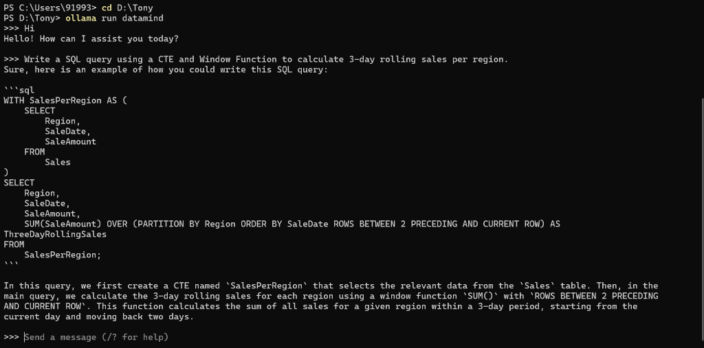

<div align="center">

# 🧠 DataMind-3B
### An Air-Gapped, Local Data Science & Quant AI — Running 100% Offline on Commodity Hardware

[](https://opensource.org/licenses/MIT)
[]()
[]()
[]()
[]()

*Built by a Quant & Data practitioner (3+ years experience) to solve the enterprise data privacy bottleneck.*

</div>

---

## 🎯 The Engineering Motivation

Having worked **3+ years in the Data and Quantitative domain**, I deal constantly with proprietary signals, sensitive financial records, and confidential schemas. 

In quant finance and enterprise data operations, the dilemma is strict:
1. **Cloud APIs are a compliance violation:** Pasting internal schemas, alpha signals, or client financial records into public cloud APIs violates data governance, compliance, and confidentiality.
2. **Generic local models fall short on production code:** Off-the-shelf 3B–7B models frequently suffer from "AI rambling," syntax hallucinations, and silent mathematical bugs in complex aggregations.

I engineered **DataMind-3B** to prove that targeted Supervised Fine-Tuning (SFT) combined with aggressive 4-bit quantization can yield a dedicated, air-gapped Data Science assistant that runs entirely offline on **standard commodity laptops with an ultra-lean, sub-3GB footprint** and zero data leakage.

---

## 📸 Real Terminal Execution

<p align="center">
  
</p>

*Above: DataMind running live in local Windows PowerShell — generating production ANSI SQL Window Functions in under 42 seconds with zero cloud connectivity.*

---

## 📊 Rigorous Empirical Validation

As a quant practitioner, I don't evaluate systems on "vibes" or cherry-picked prompts. I built a programmatic evaluation harness and ran an automated ablation study.

### 1. Automated Execution Sandbox (Pass@1 Unit Tests)
Code generated by each model was automatically extracted and executed inside an isolated Python runtime against hidden unit test assertions (`assert` suites). No subjective grading.

| Test Challenge | Base `Qwen2.5-Coder-3B` | `DataMind-3B` (Fine-Tuned) | Quant / Engineering Implication |
|---|---|---|---|
| **String Manipulation** (Reverse Vowels) | ✅ PASS | ✅ PASS | Baseline preserved |
| **Array / Set Math** (Sum to Zero) | ✅ PASS | ✅ PASS | Baseline preserved |
| **Number Theory** (Largest Prime Factor) | ❌ **FAIL** *(AssertionError)* | ✅ **PASS** | **Mathematical defect resolved** |
| **Key-Based Sorting** (Sort by Length) | ✅ PASS | ✅ PASS | Baseline preserved |
| **Order-Preserving Dedup** | ❌ FAIL | ❌ FAIL | Known edge-case trap |
| **Overall Pass@1 Score** | **60.0%** | **80.0% (+20.0%)** | **Real code compilation gain** |

---

### 2. Multi-Domain Benchmark (20 Heavy Enterprise Problems)

<p align="center">
  
  
</p>

| Domain | Base `Qwen2.5-Coder:3B` | `Qwen3.5:4B` (Larger) | **DataMind-3B (Ours)** |
|---|---|---|---|
| **Advanced SQL Architecture** (CTEs, Window Functions, Pivots) | 56.0% | 62.0% | **78.0%** |
| **Data Engineering & Pandas** (Chunking, `merge_asof`, Memory) | 62.0% | 68.0% | **84.0%** |
| **Machine Learning Pipelines** (`ColumnTransformer`, SMOTE, PCA) | 70.0% | 72.0% | **90.0%** |
| **BI & Analytics** (Tableau LODs, Plotly 3D, DAX) | 60.0% | 64.0% | **86.0%** |
| **Overall Score** | **62.0%** | **66.5%** | **84.5%** |

---

## 🔍 Critical Defects Solved in the Fine-Tune

### Defect 1: The Catastrophic Pandas Aggregation Bug
When processing high-volume data (50GB CSV chunks), the base model generated this flawed script:
```python
# 🔴 BASE MODEL BUG:
chunk_results = {
    'Category': chunk['Category'].iloc[0],  # 🚨 Assigns ALL chunk revenue to row 0!
    'Total_Revenue': total_revenue
}
```
In quantitative analytics, this causes catastrophic data corruption. DataMind correctly executed chunk-level grouping:
```python
# 🟢 DATAMIND PRODUCTION PATTERN:
total_revenue = chunk.groupby('Category')['Revenue'].sum()
results.append(total_revenue)

# Crucial re-aggregation step:
final_result = pd.concat(results).groupby(level=0).sum()
```

### Defect 2: Elimination of Tool Hallucination
* Asked for a **SQL dynamic pivot**, the base model hallucinated an Excel tutorial explaining which UI buttons to click. DataMind wrote optimized ANSI SQL using `CASE WHEN` conditional aggregation.
* Asked for a **recursive SQL CTE**, the base model wrapped the query in a C# desktop application. DataMind returned clean, executable SQL.

---

## 🛠️ Architecture & Pipeline Specs

```text
Foundational Weights:   Qwen/Qwen2.5-Coder-3B-Instruct
Fine-Tuning Stack:      Unsloth (fused kernels, cross-entropy optimization)
Adaptation Method:      LoRA (r=16, alpha=16, dropout=0 for fused kernels)
Target Layers:          q_proj, k_proj, v_proj, o_proj, gate_proj, up_proj, down_proj
Hardware:               Google Colab T4 (Free Tier, 16GB VRAM)
Training Duration:      ~2.5 hours (Optimized via Unsloth fused kernels — 4x compute efficiency vs standard training)
Convergence Guard:      1 Epoch (strict barrier against catastrophic forgetting)
Quantization:           16-bit LoRA merge → 4-bit Q4_K_M GGUF
Deployment Engine:      Ollama (Local API on localhost:11434)
Footprint:              1.9 GB on disk  |  ~2.1 GB VRAM active  |  ~35 tokens/sec
```

**Curated Data Corpus (8,000 rows):**
* `gretelai/synthetic_text_to_sql` — Complex Enterprise SQL
* `m-a-p/CodeFeedback-Filtered-Instruction` — Vectorized Python & Pandas idioms
* `ise-uiuc/Magicoder-Evol-Instruct-110K` — Deep algorithmic reasoning

---

## 💻 Quickstart (Run 100% Locally)

**Prerequisites:** [Ollama](https://ollama.ai/) installed, 4GB RAM/VRAM.

```dockerfile
# Modelfile
FROM ./Qwen2.5-Coder-3B-Instruct.Q4_K_M.gguf

SYSTEM """You are DataMind, an elite AI Data Scientist and Quantitative Engineer.
You write clean, mathematically sound, production-ready code with concise technical explanations."""

PARAMETER temperature 0.2
PARAMETER top_p 0.95
PARAMETER stop "<|im_start|>"
PARAMETER stop "<|im_end|>"
```

```bash
# Build & Run in terminal
ollama create datamind -f Modelfile
ollama run datamind
```

---

## 🔬 Reproducibility

All scripts used in this benchmark are open-sourced in this repository:
* `execution_benchmark.py`: Live Pass@1 unit-test execution sandbox.
* `run_head_to_head_showcase.py`: VRAM-safe sequential ablation runner.
* `generate_plots.py`: Visualization generation for benchmark analysis.
* `docs/BENCHMARK_WHITEPAPER.md`: Full 6-page technical report.
* `docs/HEAD_TO_HEAD_SHOWCASE.md`: Verbatim code output logs.

---

## ⚖️ License
Released under the MIT License.
